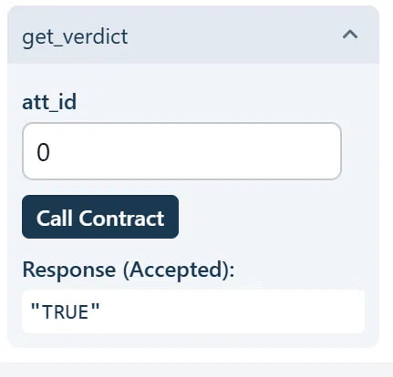
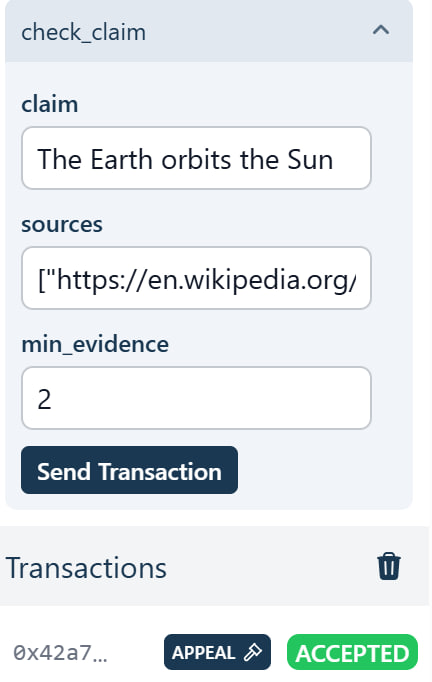
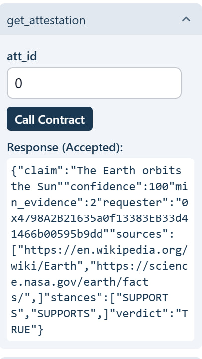

# FactCheckOracle: a reusable claim-verification primitive for GenLayer

## Purpose
Smart contracts cannot read the real world. This contract lets any other contract ask:
**"Is this claim true, according to these sources?"** and get back one settled answer
(`TRUE`, `FALSE`, or `UNCLEAR`) with a confidence score, stored on-chain as an attestation.

Useful for prediction markets, parametric insurance, escrow release, DAO governance, and
bounty or milestone checks.

## Why it is not a thin LLM wrapper
| Layer | Who decides |
|---|---|
| Read each web source | Validators (non-deterministic) |
| Classify each source: `SUPPORTS` / `REFUTES` / `NEUTRAL` | LLM, strict enum only |
| Turn stances into a verdict | **Deterministic contract code** (`aggregate`) |
| Accept or reject the leader | **Custom equivalence rule** (`equivalent`) |

The LLM never outputs the final verdict. It only labels sources. The rules that turn labels into
a verdict are plain code that anyone can audit.

## How consensus works
1. The leader fetches all sources and classifies each one.
2. Every validator repeats the same work independently.
3. A validator accepts the leader only if:
   - both stance sets lead to the **same verdict** (the leader's claimed verdict is re-derived, never trusted),
   - **at most 1 source** is labelled differently,
   - confidence differs by **20 points or less** (confidence is bucketed in steps of 10).
4. The verdict is computed from the agreed stances and stored.

## Verdict rules
- Fewer than `min_evidence` decisive sources (SUPPORTS or REFUTES) -> `UNCLEAR`
- 75% or more of decisive sources support -> `TRUE`
- 25% or less support -> `FALSE`
- Anything in between -> `UNCLEAR`

## State design
`attestations: TreeMap[u256, Attestation]` is append-only. Each record holds the claim,
requester, sources, per-source stances, verdict, confidence and `min_evidence`. Records are never
edited, so downstream protocols can rely on them. A new check creates a new attestation.

## API
| Method | Type | Description |
|---|---|---|
| `check_claim(claim, sources, min_evidence=2)` | write | Verify a claim, return attestation id |
| `get_verdict(id)` | view | `TRUE` / `FALSE` / `UNCLEAR` / `NOT_FOUND` |
| `get_attestation(id)` | view | Full record |
| `count()` | view | Number of attestations |

Limits: 1-5 unique sources, claim up to 500 chars, `1 <= min_evidence <= number of sources`.

## Reuse example
`claim_gated_escrow.py` reads the oracle and moves to `RELEASED`, `REFUNDED`, or stays in `HOLD`.

## Known limits (honest notes)
- Quality depends on the sources you pass. Pick independent, reputable URLs.
- Pages that block scraping are treated as `NEUTRAL`.
- Best for factual, checkable claims, not opinions.

## Files
- `fact_check_oracle.py`: the primitive
- `claim_gated_escrow.py`: example consumer
- `test_fact_check_oracle.py`: unit tests for the consensus rules plus an integration sketch

## Tested on GenLayer Studio
Test claim: "The Earth orbits the Sun"

Both contracts were deployed and tested in GenLayer Studio. The oracle settled the claim as `TRUE`, and the escrow read that verdict and moved to `RELEASED`.

